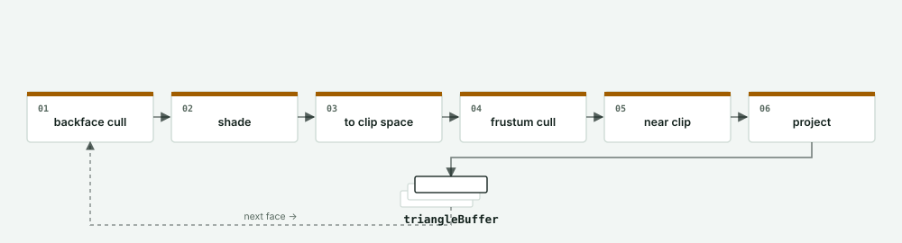
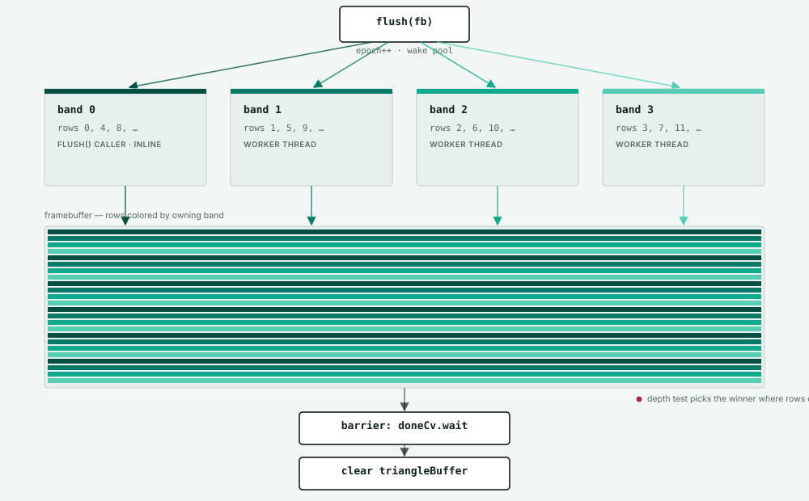
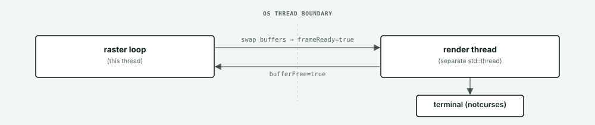

# Usage:

Experimental variant of terminal-graphics that rasterizes each frame across a persistent thread pool instead of a single thread. See [Render pipeline](#render-pipeline) below for how a frame moves through it.

## Dependencies

notcurses:
```
sudo apt-get install build-essential cmake doctest-dev libavdevice-dev libdeflate-dev libgpm-dev libncurses-dev libqrcodegen-dev libswscale-dev libunistring-dev pandoc pkg-config
```

## Build

```
cmake -S . -B build
cmake --build build
```

## Run

Run from the repository root — model paths (e.g. `assets/pyramid.obj`) are loaded relative to the current working directory:

```
./build/terminal_graphics
```

There is no in-app quit key yet; exit with Ctrl+C.

## Controls

- Mouse drag: look around
- Arrow keys: look around
- `w` / `a` / `s` / `d`: move forward / left / back / right

## Render pipeline

Each frame runs through two passes with a hard boundary between them: `Rasterizer::draw()` walks the scene's geometry sequentially, and `Rasterizer::flush()` fills pixels in parallel.

**1. Geometry — single thread.** `draw()` runs the same six steps per face, in this order, for every object; survivors are appended to a shared `triangleBuffer`.



**2. Rasterize — thread pool.** `flush()` wakes a pool of workers and splits the framebuffer's rows round robin: row `y` always goes to thread `y % N` (`N = hardware_concurrency()`, drawn here as 4), so any one thread's rows stay spread evenly down the screen instead of clustered in a strip. Every band reads the same `triangleBuffer` and writes disjoint rows, so no locking is needed.



**3. Present — separate thread.** Once every band finishes, the raster loop flips the framebuffer's front/back index and signals `frameReady` — no pixel data is copied. A separate render thread draws the front buffer to the terminal via notcurses, then signals `bufferFree` so the raster loop can start the next frame.



# To-do:
- 